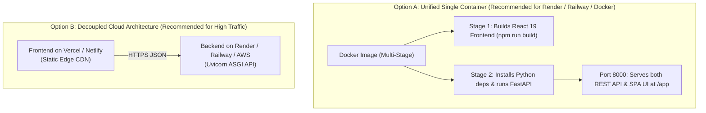

# ModelWatch: Production Deployment & Cloud Hosting Guide

This guide details how to deploy the **ModelWatch** platform to production across free cloud hosts, container registries, or dedicated virtual private servers (VPS).

---

## 🏗️ Deployment Architecture Options



---

## 🚀 Option 1: Free 1-Click Deployment on Render.com (Recommended)

Render provides a generous free tier for web services with automated GitHub deployment and built-in SSL.

### Step 1: Push Repository to GitHub
Ensure all code and configuration files are committed and pushed to your GitHub repository:
```bash
git add .
git commit -m "feat: production deployment config with Dockerfile and render.yaml"
git push origin main
```

### Step 2: Create Web Service on Render
1. Navigate to [dashboard.render.com](https://dashboard.render.com).
2. Click **New +** > **Web Service**.
3. Select your repository: `ManishKumar3371-sys/ModelWatch`.
4. Choose **Docker** as the Runtime (Render automatically detects [Dockerfile](file:///c:/Users/MANISHKUMAR/OneDrive/Desktop/ModelWatch/Dockerfile)).
5. Configure Environment Variables in the Render UI:
   - `ENVIRONMENT`: `production`
   - `DISABLE_EMAIL_ALERT`: `1` (or `0` if you configure Gmail credentials)
   - `PORT`: `8000`
6. Click **Deploy Web Service**.

Render will automatically build the React frontend, configure the Python environment, and expose your live URL (e.g. `https://modelwatch-api.onrender.com`).
- Interactive UI: `https://modelwatch-api.onrender.com/app`
- OpenAPI Swagger Docs: `https://modelwatch-api.onrender.com/docs`
- Health Probe: `https://modelwatch-api.onrender.com/health`

---

## 🚆 Option 2: 1-Click Deployment on Railway.app

Railway detects the [Procfile](file:///c:/Users/MANISHKUMAR/OneDrive/Desktop/ModelWatch/Procfile) and [Dockerfile](file:///c:/Users/MANISHKUMAR/OneDrive/Desktop/ModelWatch/Dockerfile) automatically.

1. Navigate to [railway.app](https://railway.app) and click **New Project**.
2. Select **Deploy from GitHub repo** > `ModelWatch`.
3. Add Variables:
   - `ENVIRONMENT`: `production`
   - `DISABLE_EMAIL_ALERT`: `1`
4. Railway will build the container and generate a public `*.up.railway.app` HTTPS domain.

---

## 🐳 Option 3: Local or VPS Deployment with Docker Compose

To run ModelWatch in an isolated container on any machine or VPS with Docker installed:

```bash
# 1. Build and start the container in the background
docker compose up --build -d

# 2. Check running status and health check
docker compose ps

# 3. View live production logs
docker compose logs -f
```

- Open `http://localhost:8000/app` for the UI.
- Open `http://localhost:8000/docs` for API documentation.

To stop the container:
```bash
docker compose down
```

---

## ⚡ Option 4: Decoupled Deployment (Vercel Frontend + Render Backend)

For maximum frontend performance using Vercel's global edge network:

### 1. Deploy Backend on Render / Railway
Deploy using [Dockerfile](file:///c:/Users/MANISHKUMAR/OneDrive/Desktop/ModelWatch/Dockerfile) as in Option 1. Copy your live backend URL (e.g. `https://modelwatch-api.onrender.com`).

### 2. Configure Frontend API URL
In `frontend/src/App.jsx`, configure the API URL from environment variable or production endpoint:
```javascript
const API_URL = import.meta.env.VITE_API_URL || "https://modelwatch-api.onrender.com";
```

### 3. Deploy on Vercel
1. Go to [vercel.com](https://vercel.com) > **Add New Project**.
2. Import `ModelWatch`.
3. Set **Root Directory** to `frontend`.
4. Framework Preset: **Vite**.
5. Add Environment Variable:
   - `VITE_API_URL`: `https://modelwatch-api.onrender.com`
6. Click **Deploy**.

---

## 🖥️ Option 5: Bare-Metal Ubuntu VPS (Nginx + Systemd + Let's Encrypt)

For deployment on AWS EC2, DigitalOcean Droplet, or Linode:

```bash
# 1. System updates & Python setup
sudo apt update && sudo apt install -y python3-pip python3-venv git nginx

# 2. Clone repo and create venv
git clone https://github.com/ManishKumar3371-sys/ModelWatch.git /var/www/modelwatch
cd /var/www/modelwatch
python3 -m venv venv
./venv/bin/pip install -r requirements.txt

# 3. Build frontend
curl -fsSL https://deb.nodesource.com/setup_20.x | sudo -E bash -
sudo apt install -y nodejs
cd /var/www/modelwatch/frontend && npm ci && npm run build

# 4. Create Systemd Service (/etc/systemd/system/modelwatch.service)
sudo nano /etc/systemd/system/modelwatch.service
```

Paste the following service definition:
```ini
[Unit]
Description=ModelWatch MLOps Production Service
After=network.target

[Service]
User=ubuntu
WorkingDirectory=/var/www/modelwatch
ExecStart=/var/www/modelwatch/venv/bin/uvicorn backend.main:app --host 127.0.0.1 --port 8000 --workers 3
Restart=always
Environment="PATH=/var/www/modelwatch/venv/bin"
EnvironmentFile=/var/www/modelwatch/.env

[Install]
WantedBy=multi-user.target
```

Enable and start:
```bash
sudo systemctl daemon-reload
sudo systemctl enable --now modelwatch
sudo systemctl status modelwatch
```

Configure Nginx reverse proxy and SSL via Certbot:
```bash
sudo apt install -y certbot python3-certbot-nginx
sudo certbot --nginx -d yourdomain.com
```

---

## 🔒 Production Environment Variables

| Variable | Recommended Production Value | Description |
|:---|:---|:---|
| `ENVIRONMENT` | `production` | Enables production error sanitization |
| `PORT` | `8000` | Port listened to by Uvicorn |
| `HOST` | `0.0.0.0` | Bind host for cloud containers |
| `DISABLE_EMAIL_ALERT` | `1` (or `0`) | Set to `0` when Gmail SMTP is configured |
| `CORS_ORIGINS` | `https://yourdomain.com,https://modelwatch.vercel.app` | Allowed frontend domains |
| `GMAIL_SENDER_EMAIL` | `alerts@domain.com` | Alert sender email address |
| `GMAIL_APP_PASSWORD` | `16-char-app-password` | Google Account App Password |
| `ALERT_RECEIVER_EMAIL`| `devops@domain.com` | Incident subscriber email address |

---

## ✅ Post-Deployment Verification Checklist

Once deployed, verify:
- [ ] `GET /health` returns `{"status": "healthy", "project": "ModelWatch"}`
- [ ] `GET /docs` loads Swagger interactive API documentation
- [ ] `GET /state-data-tracker` returns 36 state records and launch pilot metrics
- [ ] `POST /predict-house-price` returns valid valuation for Pune/Prayagraj
- [ ] Frontend UI loads smoothly with Sage/Off-White/Tomato palette
