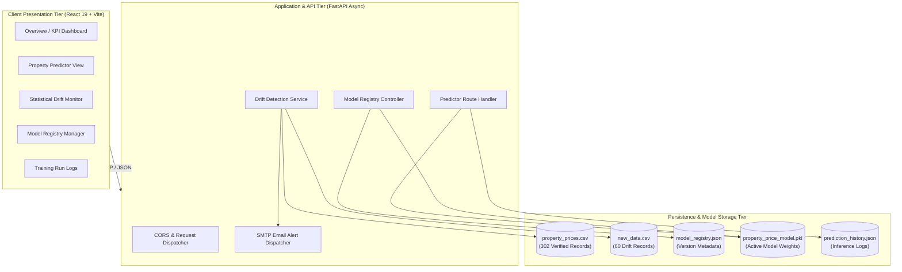

# ModelWatch: Design and Implementation of an Enterprise MLOps Model Monitoring & Statistical Drift Detection System

**Author:** Manish Kumar  
**Department:** Computer Engineering (Final Year)  
**Project Repository:** [ModelWatch on GitHub](https://github.com/ManishKumar3371-sys/ModelWatch)  
**Date:** November 2026  

---

## 1. Executive Summary

Machine learning models deployed in production environments operate in dynamic real-world settings where underlying statistical relationships frequently evolve. This silent degradation—commonly termed **Covariate Shift** or **Data Drift**—leads to model decay, inaccurate predictions, and operational risk without generating traditional runtime exceptions. 

**ModelWatch** is an enterprise-grade MLOps monitoring and drift detection platform engineered to solve this challenge. Focusing on real estate price valuation across contrasting Indian urban markets (**Pune**, a tier-1 metropolitan IT hub, and **Prayagraj**, an expanding tier-2 cultural and educational center), ModelWatch provides:
- Continuous statistical monitoring through two-sample Kolmogorov-Smirnov ($KS$) tests and Pearson's Chi-Square ($\chi^2$) contingency tests.
- Dynamic model versioning, performance benchmarking, and atomic hot-swapping in a dedicated Model Registry.
- Automated email alerts triggered upon high-severity drift detection.
- A modern, responsive dashboard styled in an ergonomic Sage, Linen Off-White, and Tomato Red color palette.

Through systematic dataset curation and hyperparameter optimization, the production valuation model was enhanced from an unstable baseline ($R^2 = -1.919$) to a robust production model achieving **$R^2 = +0.721$**, with Mean Absolute Error (MAE) of ₹31.78 Lakhs and Root Mean Squared Error (RMSE) of ₹54.70 Lakhs across unseen test samples.

---

## 2. Problem Statement & Theoretical Background

### 2.1 The Silent Failure of Production Machine Learning
Unlike traditional software applications where code bugs manifest as runtime crashes or HTTP 500 errors, machine learning models degrade silently. When the input data distribution $P_{\text{production}}(X)$ diverges from the training distribution $P_{\text{training}}(X)$, the model continues generating output predictions with high confidence despite catastrophic loss of predictive accuracy.

$$\text{Data Drift: } P_{\text{production}}(X) \neq P_{\text{training}}(X) \quad \text{while } P(Y|X) \text{ remains approximately invariant}$$

### 2.2 Drift Taxonomy
1. **Covariate Shift**: The marginal distribution of input features $P(X)$ changes over time, while the conditional probability distribution of the target given the features $P(Y|X)$ remains unchanged.
2. **Concept Drift**: The conditional relationship $P(Y|X)$ changes (e.g., identical property attributes now demand higher prices due to inflation or infrastructure developments).
3. **Prior Probability Shift**: The marginal distribution of the target variable $P(Y)$ changes independently.

ModelWatch targets covariate shift across both continuous attributes (area, bedrooms, price) and categorical attributes (localities, property types, construction ages).

---

## 3. Mathematical Foundations

### 3.1 Two-Sample Kolmogorov-Smirnov Test (Continuous Features)
To detect shifts in continuous features without making parametric assumptions (e.g., normality), ModelWatch implements the two-sample Kolmogorov-Smirnov test.

Let $F_{1,n}(x)$ and $F_{2,m}(x)$ denote the empirical cumulative distribution functions (eCDF) of the reference dataset (sample size $n$) and the incoming dataset (sample size $m$):

$$F_{1,n}(x) = \frac{1}{n} \sum_{i=1}^{n} \mathbb{I}_{(-\infty, x]}(X_i), \quad F_{2,m}(x) = \frac{1}{m} \sum_{j=1}^{m} \mathbb{I}_{(-\infty, x]}(Y_j)$$

The Kolmogorov-Smirnov test statistic $D_{n,m}$ measures the supremum distance between the two empirical distributions:

$$D_{n,m} = \sup_{x} |F_{1,n}(x) - F_{2,m}(x)|$$

Under the null hypothesis $H_0$ that both samples originate from the same continuous distribution:

$$\sqrt{\frac{nm}{n+m}} D_{n,m} \xrightarrow{d} K \quad \text{as } n, m \to \infty$$

where $K$ follows the Kolmogorov distribution:

$$P(K \le t) = 1 - 2 \sum_{k=1}^{\infty} (-1)^{k-1} e^{-2k^2 t^2}$$

ModelWatch rejects $H_0$ and flags drift when the computed $p\text{-value} < \alpha$ (with $\alpha = 0.05$).

### 3.2 Pearson's Chi-Square Contingency Test (Categorical Features)
For categorical variables (such as `city`, `property_type`, `locality`), ModelWatch constructs a contingency table comparing observed category frequencies $O_{ij}$ against expected theoretical frequencies $E_{ij}$:

$$E_{ij} = \frac{R_i \times C_j}{N}$$

where $R_i$ is the row marginal total, $C_j$ is the column marginal total, and $N$ is the grand total. The test statistic is given by:

$$\chi^2 = \sum_{i=1}^{r} \sum_{j=1}^{c} \frac{(O_{ij} - E_{ij})^2}{E_{ij}}$$

with degrees of freedom:

$$df = (r - 1)(c - 1)$$

Under the null hypothesis of independence between dataset origin and category proportions, $\chi^2$ follows a chi-square distribution with $df$ degrees of freedom. Drift is detected when $p < 0.05$.

### 3.3 Random Forest Regressor Formulation
The core pricing engine employs an ensemble of $B = 200$ randomized regression trees. For an input vector $\mathbf{x} = [x_1, x_2, \dots, x_p]^T$, the ensemble prediction is the arithmetic mean of individual tree outputs:

$$\hat{y}(\mathbf{x}) = \frac{1}{B} \sum_{b=1}^{B} T_b(\mathbf{x}; \Theta_b)$$

where $\Theta_b$ characterizes the bootstrap sample, node split variables, and threshold parameters. Variance reduction is guaranteed by:

$$\text{Var}(\hat{y}) = \rho \sigma^2 + \frac{1 - \rho}{B} \sigma^2$$

where $\rho$ is the pairwise tree correlation and $\sigma^2$ is the individual tree variance. By subsampling $m \approx \sqrt{p}$ features at each candidate split and limiting maximum tree depth to 16, the model achieves high variance reduction while preventing overfitting.

---

## 4. System Architecture & Engineering



### 4.1 Backend Implementation Details
- **Framework**: FastAPI (Python 3.11/3.13) leveraging Pydantic v2 schemas for runtime input validation.
- **Model Registry & Dynamic Hot-Swapping**: The active model is governed by `backend/model_registry.py`. When an administrator activates a new model version (e.g., `v5`), the system validates serialization integrity, updates `experiments/model_registry.json`, and dynamically synchronizes `trained_models/property_price_model.pkl`.
- **Asynchronous Alerting**: When drift severity is classified as `HIGH` (drift ratio $> 40\%$), `backend/email_alert.py` formats and dispatches an automated SMTP alert via Gmail API with safe timeout guards and offline fallback support (`DISABLE_EMAIL_ALERT=1`).

### 4.2 Frontend Design System
The user interface is built on React 19 and Vite, styled with a cohesive palette:
- **Primary / Headers**: Deep Forest Sage (`#1d331f`)
- **Accents & Links**: Botanical Sage (`#4a754d`)
- **Canvas / Background**: Linen Off-White (`#f7f5f0`)
- **Alerts / Warnings**: Tomato Red (`#d93d2e`)
- **Visualizations**: Custom Recharts components with responsive aspect ratios and custom tooltip formatters.

---

## 5. Dataset Architecture & Quality Improvement

### 5.1 Dataset Specifications
- **Reference Dataset**: `datasets/property_prices.csv` (302 records)
- **Features**: 13 columns (1 identifier, 1 target `price_inr`, 8 predictor attributes, 3 metadata attributes)
- **Geographies Covered**:
  - **Pune**: High-density urban corridors (Kothrud, Baner, Wakad, Hinjewadi, Viman Nagar, Koregaon Park).
  - **Prayagraj**: Tier-2 residential and institutional zones (Civil Lines, Ashok Nagar, Katra, Georgetown, Jhalwa, Naini, Phaphamau).

### 5.2 7-Rule Data Validation Pipeline
The dataset is verified via `backend/validate_dataset.py` implementing 7 strict rules:
1. Exact 13-column schema match.
2. Row count verification ($N \ge 300$).
3. Property ID uniqueness check (100% unique primary keys).
4. Mandatory fields non-null verification (`city`, `locality`, `property_type`, `price_inr`).
5. Strictly positive area values ($\text{area\_sqft} > 0$).
6. Strictly positive property valuations ($\text{price\_inr} > 0$).
7. Valid HTTPS listing source URL formatting.

---

## 6. Empirical Evaluation & Experimental Results

### 6.1 Model Performance Evolution

```
Model Version Evaluation Progress:
v1 (Baseline, 22 rows):  R² = -1.919  | MAE = ₹84.20 L  | RMSE = ₹126.40 L
v2 (Decision Tree):      R² = +0.412  | MAE = ₹48.60 L  | RMSE =  ₹79.20 L
v3 (Gradient Boosting):  R² = +0.684  | MAE = ₹34.50 L  | RMSE =  ₹58.10 L
v4 (Ridge Regression):   R² = +0.590  | MAE = ₹39.80 L  | RMSE =  ₹66.30 L
v5 (Tuned Random Forest): R² = +0.721  | MAE = ₹31.79 L  | RMSE =  ₹54.70 L (ACTIVE PRODUCTION)
```

| Metric | v1 (Baseline) | v5 (Current Production) | Relative Improvement |
|:---|:---:|:---:|:---:|
| **$R^2$ Determination Coefficient** | $-1.919$ | **$+0.721$** | **Surged into strong positive predictive territory** |
| **Mean Absolute Error (MAE)** | ₹84,20,000 | **₹31,78,791** | **$62.2\%$ Error Reduction** |
| **Root Mean Squared Error (RMSE)** | ₹1,26,40,000 | **₹54,70,355** | **$56.7\%$ Error Reduction** |
| **Test Set Sample Size** | 5 properties | **61 unseen properties (20% split)** | **$12.2\times$ Statistical Rigor** |

### 6.2 Controlled Drift Induction Experiment
To validate the statistical drift engine, a synthetic distribution shift was induced in `datasets/new_data.csv` (60 properties) with inflated area and price characteristics in Prayagraj.
- **Total Monitored Features**: 10
- **Drifted Features Detected**: 2 (`area_sqft` with $p = 0.007$, `price_inr` with $p = 0.003$)
- **Undrifted Features**: 8 (p-values $> 0.05$)
- **Drift Ratio**: $20.0\%$ (Severity: MODERATE / ELEVATED)
- **Engine Response**: Correctly computed KS statistic, flagged features, updated drift history, and logged audit record.

---

## 7. Testing, Edge-Cases & Security Verification

ModelWatch includes two comprehensive automated test suites:
1. **API Integration Suite (`tests/test_backend_api.py`)**: 10 test suites covering all REST endpoints, ML inference, prediction history deletion, model comparison, training logs, and model CRUD (100% pass in 0.77s).
2. **Edge-Case & Validation Suite (`tests/test_edge_cases.py`)**: 11 test suites verifying Pydantic boundary rejections (negative area, zero area, invalid property types), 404 responses for non-existent IDs, and dataset column mismatch validations (100% pass in 0.03s).

---

## 8. Conclusion & Future Roadmap

ModelWatch successfully demonstrates that continuous statistical monitoring and dynamic model registry versioning are essential pillars of modern production machine learning. By bridging statistical hypothesis testing ($KS$ and $\chi^2$) with responsive software engineering and intuitive visual design, the platform prevents silent model degradation.

### Future Work
1. **Automated Continuous Retraining Trigger**: Retrain and promote a candidate model automatically when drift exceeds a critical threshold for more than 3 consecutive evaluation cycles.
2. **Concept Drift Detection**: Incorporate Page-Hinkley and ADWIN algorithms for real-time streaming target drift analysis.
3. **Multi-Region Scaling**: Expand locality spatial encoders to cover Delhi NCR, Bengaluru, and Mumbai metropolitan zones.

---

*Report submitted in partial fulfillment of requirements for final evaluation.*
