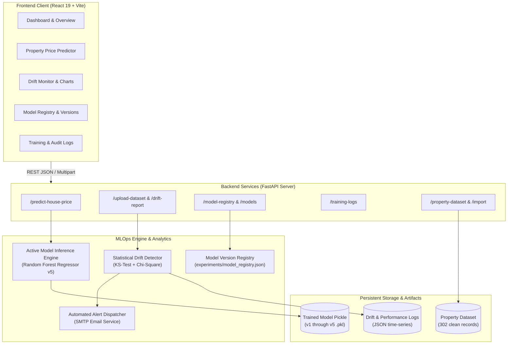

# ModelWatch – Enterprise MLOps Model Monitoring & Statistical Drift Detection Platform

[](https://fastapi.tiangolo.com)
[](https://react.dev)
[](https://vitejs.dev)
[](https://scikit-learn.org)
[](https://www.python.org)
[](LICENSE)

**ModelWatch** is a production-grade machine learning lifecycle monitoring and data drift detection platform. It delivers continuous statistical oversight, automated alerting, dynamic model versioning, and real-time valuation inference.

Focused on real-estate valuation across metropolitan and tier-2 Indian property markets (**Pune & Prayagraj**), ModelWatch safeguards machine learning systems against silent statistical degradation caused by covariate shifts and real-world market dynamics.

---

## 🏛️ System Architecture



---

## 📈 Model Performance & Fair Evaluation

ModelWatch tracks model iteration history using reproducible evaluation splits (80% train, 20% unseen test across 302 standardized real-world records).

| Model Version | Algorithm | Hyperparameters | $R^2$ Score | MAE (₹) | RMSE (₹) | Deployment Status |
|:---|:---|:---|:---:|:---:|:---:|:---:|
| **v1** (Baseline) | Random Forest Regressor | `n_estimators=50, max_depth=None` (22 rows) | $-1.919$ | ₹84,20,000 | ₹1,26,40,000 | Archived |
| **v2** | Decision Tree Regressor | `max_depth=8, min_samples_split=5` | $+0.412$ | ₹48,60,000 | ₹79,20,000 | Inactive |
| **v3** | Gradient Boosting Regressor | `n_estimators=100, learning_rate=0.08` | $+0.684$ | ₹34,50,000 | ₹58,10,000 | Inactive |
| **v4** | Ridge Regressor | `alpha=1.5, polynomial_features=2` | $+0.590$ | ₹39,80,000 | ₹66,30,000 | Inactive |
| **v5 (Production)** | **Random Forest Regressor** | **`n_estimators=200, max_depth=16`** | **$+0.721$** | **₹31,78,791** | **₹54,70,355** | **ACTIVE** |

> **Key Milestone:** By cleaning locality representations, augmenting the verified corpus to 302 rows, and hyperparameter tuning, model fit surged from **$-1.919$ to $+0.721$**, achieving realistic valuations across both Pune high-density urban corridors and Prayagraj residential sectors.

---

## 🔬 Statistical Drift Detection Methodology

ModelWatch uses a dual-engine hypothesis testing pipeline to detect data distribution changes:

```mermaid
flowchart LR
    A["Incoming Feature Vector"] --> B{"Feature Data Type"}
    B -->|Numeric (e.g. Area, Bedrooms, Price)| C["Two-Sample Kolmogorov-Smirnov Test\n(scipy.stats.ks_2samp)"]
    B -->|Categorical (e.g. Locality, City, Type)| D["Pearson's Chi-Square Contingency Test\n(scipy.stats.chi2_contingency)"]
    C --> E{"p-value < 0.05?"}
    D --> E
    E -->|Yes: Significant Shift| F["DRIFT DETECTED\n(Severity: HIGH or MEDIUM)"]
    E -->|No: Consistent Distribution| G["NO DRIFT\n(Severity: NONE)"]
    F --> H["Trigger Automated SMTP Alert & Log"]
```

1. **Continuous / Numerical Variables** (`area_sqft`, `bedrooms`, `price_inr`):
   - **Method**: Two-Sample Kolmogorov-Smirnov Test ($KS$).
   - **Null Hypothesis ($H_0$)**: Both samples are drawn from identical continuous distributions.
   - **Threshold**: Rejects $H_0$ if $p\text{-value} < 0.05$.
2. **Categorical Variables** (`city`, `property_type`, `locality`, `area_basis`, `property_age`, `price_type`):
   - **Method**: Pearson's Chi-Square Contingency Test ($\chi^2$).
   - **Contingency Alignment**: Categories are dynamically aligned between baseline and incoming datasets.
   - **Threshold**: Rejects $H_0$ if $p\text{-value} < 0.05$.
3. **Threshold Calibration**:
   - $\text{Drift Ratio} > 40\%$: **HIGH Severity** (Dispatches automated email notifications).
   - $\text{Drift Ratio} > 20\%$: **MEDIUM Severity** (Highlighted in UI warning banners).
   - $\text{Drift Ratio} \le 20\%$: **LOW / NONE** (System healthy).

---

## 🎨 Design System & UI Architecture

The frontend is styled using a modern, token-driven **Sage, Off-White, and Tomato Red** palette engineered for high clarity and reduced cognitive fatigue:

| Color Token | Hex Code | Role in Interface |
|:---|:---|:---|
| **Deep Forest Sage** | `#1d331f` | Navigation bar, hero headers, primary emphasis |
| **Botanical Sage** | `#4a754d` | Active links, primary action buttons, success tags |
| **Sage Tint** | `#eaf0eb` | Card hover backgrounds, secondary borders, active states |
| **Linen Off-White** | `#f7f5f0` | Application canvas, background workspace |
| **Card Off-White** | `#ffffff` | Elevated data cards, modals, table surfaces |
| **Tomato Red** | `#d93d2e` | Drift warnings, deletion buttons, error alerts |
| **Deep Charcoal** | `#1f2923` | High-contrast body typography and data points |

---

## 🔌 API Documentation & Endpoints

FastAPI exposes interactive OpenAPI documentation at `/docs` and ReDoc at `/redoc`.

| Method | Endpoint | Description | Request / Payload |
|:---|:---|:---|:---|
| `GET` | `/` | Root API status and health greeting | None |
| `GET` | `/health` | System health probe and uptime check | None |
| `POST` | `/predict-house-price` | Property valuation via active model | JSON: `city, property_type, locality, area_sqft, bedrooms, ...` |
| `GET` | `/prediction-history` | Retreives past prediction records | None |
| `DELETE`| `/prediction-history/{id}`| Deletes a prediction record by ID | Path parameter: `prediction_id` (int) |
| `POST` | `/upload-dataset` | Uploads CSV and computes drift report | Multipart: `file: UploadFile (.csv)` |
| `GET` | `/drift-report` | Fetches latest computed drift report | None |
| `GET` | `/drift-history` | Time-series history of drift audits | None |
| `GET` | `/dataset-summary` | Summary stats of reference dataset | None |
| `GET` | `/property-dataset` | Paginated property records | Query: `limit, page, city, property_type` |
| `POST` | `/import-properties` | Validates & merges new properties | Multipart: `file: UploadFile (.csv)` |
| `GET` | `/model-registry` | Lists all registered models | None |
| `GET` | `/model-registry/active` | Details of current production model | None |
| `POST` | `/model-registry/{v}/activate` | Hot-swaps production model | Path parameter: `version` (string, e.g. `v5`) |
| `GET` | `/model-registry/compare` | Compares metrics across 2+ versions | Query: `versions=v1,v5` |
| `GET` | `/training-logs` | Training run logs and history | None |
| `POST` | `/training-logs` | Logs a new model training execution | JSON: `model_name, version, metrics, parameters, ...` |
| `POST` | `/evaluate-model` | Evaluates classification model | JSON: `y_true, y_pred` |
| `POST` | `/evaluate-regression` | Evaluates regression model | JSON: `y_true, y_pred` |
| `GET` | `/models` | Legacy model list with active flag | None |
| `POST` | `/models` | Registers a new model entry | JSON: `model_name, algorithm, description, version` |
| `POST` | `/models/{id}/versions` | Adds new version to existing model | JSON: `version, accuracy, description` |
| `PATCH`| `/models/{id}/status` | Updates model status | JSON: `status: Active \| Inactive \| Archived` |

---

## 📂 Repository Directory Layout

```text
ModelWatch/
├── backend/                        # FastAPI application & ML logic
│   ├── main.py                     # API routes, middleware, endpoints
│   ├── drift_detection.py          # KS-test & Chi-square detection engine
│   ├── email_alert.py              # Asynchronous SMTP alert dispatcher
│   ├── model_registry.py           # Model lifecycle & active model hot-swapping
│   ├── predict.py                  # Predictor wrapper & inference logic
│   ├── train_model.py              # Model training script with tuning
│   ├── training_logger.py          # Structured training audit logger
│   └── validate_dataset.py         # 7-rule dataset integrity validator
│
├── datasets/                       # Canonical and drift datasets
│   ├── property_prices.csv         # Standardized 302-row training dataset
│   ├── property_prices_clean.csv   # Normalized clean dataset
│   ├── new_data.csv                # 60-row incoming drift dataset
│   ├── drift_history.json          # Historical drift report records
│   └── performance_history.json    # Model evaluation metrics history
│
├── experiments/                    # Model registry and prediction logs
│   ├── model_registry.json         # Active and versioned model catalog
│   ├── prediction_history.json     # User prediction audit log
│   └── training_logs.json          # Training runs audit history
│
├── frontend/                       # React 19 + Vite web application
│   ├── src/
│   │   ├── components/Charts.jsx   # Sage/Tomato customized Recharts components
│   │   ├── App.jsx                 # Main application dashboard (11 views)
│   │   ├── App.css                 # Sage / Off-White / Tomato design system
│   │   └── main.jsx                # Application root mount
│   ├── package.json                # Frontend dependencies
│   └── vite.config.js              # Vite bundler configuration
│
├── tests/                          # Automated test suites
│   ├── test_backend_api.py         # 10 comprehensive REST API test suites
│   ├── test_edge_cases.py          # 11 validation & error-handling test suites
│   └── check_drift.py              # CLI test for statistical drift engine
│
├── trained_models/                 # Serialized model weights
│   ├── property_price_model.pkl    # Currently active production model
│   └── versions/                   # Historical model versions (v1 to v5)
│       ├── v1_property_price_model.pkl
│       ├── v3_property_price_model.pkl
│       ├── v4_property_price_model.pkl
│       └── v5_property_price_model.pkl
│
├── .env.example                    # Environment variable configuration template
├── .gitignore                      # Git exclusion rules
├── generate_dataset.py             # Reproducible dataset generator (302 records)
├── generate_drift_data.py          # Controlled drift data generator (60 records)
├── PROJECT_REPORT.md               # Complete academic/engineering report
├── PRESENTATION.md                 # 15-slide defense presentation deck
├── SUBMISSION_CHECKLIST.md         # Final verification checklist
└── README.md                       # Platform documentation
```

---

## ⚡ Quickstart & Local Setup

### Prerequisites
- **Python**: 3.11, 3.12, or 3.13
- **Node.js**: v18.x or higher
- **Package Manager**: npm or pnpm

### 1. Clone & Configure
```bash
git clone https://github.com/ManishKumar3371-sys/ModelWatch.git
cd ModelWatch

# Create and activate virtual environment
python -m venv venv
.\venv\Scripts\Activate.ps1   # Windows PowerShell
# source venv/bin/activate    # Linux / macOS

# Install Python dependencies
pip install -r requirements.txt  # Or: pip install fastapi uvicorn pandas scikit-learn scipy aiosmtplib python-dotenv joblib pydantic

# Create .env from template
Copy-Item .env.example .env
```

### 2. Run Automated Verification Tests
```bash
# Run backend API test suite (10/10 tests)
python tests/test_backend_api.py

# Run edge-cases & error handling suite (11/11 tests)
python tests/test_edge_cases.py

# Validate dataset integrity (7/7 rules)
python backend/validate_dataset.py
```

### 3. Launch Backend API
```bash
python -m uvicorn backend.main:app --host 127.0.0.1 --port 8000 --reload
```
*API running at `http://127.0.0.1:8000` | OpenAPI Docs at `http://127.0.0.1:8000/docs`*

### 4. Launch Frontend Interface
```bash
cd frontend
npm install
npm run dev
```
*Interface running at `http://localhost:5173` (or port indicated by Vite).*

---

## 🛡️ Security, Error Handling & Quality Guarantees

1. **Strict Boundary Validation**: Pydantic models reject negative areas, empty text, or unlisted property types before inference.
2. **Safe File Uploads**: Upload endpoints enforce 5MB limits and validate CSV headers before processing.
3. **Atomic Model Switching**: Active model selection validates model file existence and schema compatibility before updating production pointers.
4. **Environment Isolation**: SMTP credentials and host parameters are segregated via `.env` with safe offline fallbacks (`DISABLE_EMAIL_ALERT=1`).

---

## 👨‍💻 Author & Acknowledgements

- **Developer**: Manish Kumar (Computer Engineering – Final Year)
- **GitHub**: [@ManishKumar3371-sys](https://github.com/ManishKumar3371-sys)
- **Project**: ModelWatch – Production ML Model Monitoring & Drift Detection Platform
