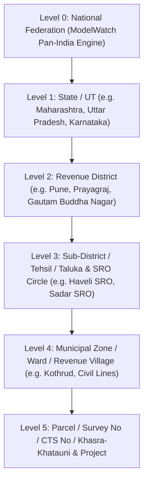
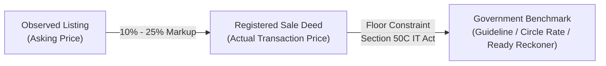
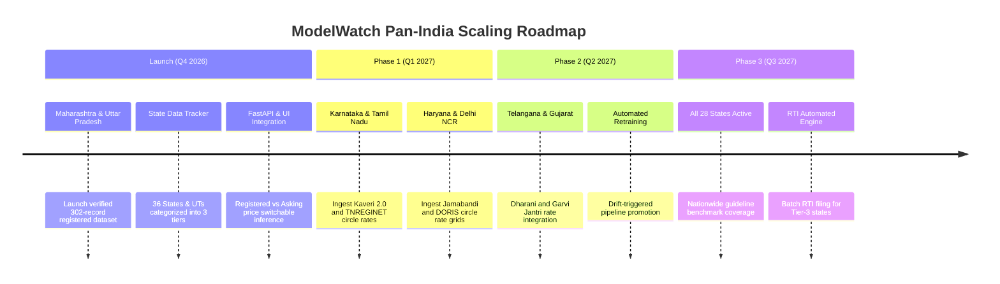

# ModelWatch: Pan-India Real Estate Data Architecture
## Technical Blueprint, Valuation Hierarchy, and Pilot Rollout for Maharashtra & Uttar Pradesh

---

## 1. Executive Vision & The Realist Path

A common pitfall in Indian PropTech and ML monitoring systems is assuming that a unified, standardized pan-India transaction database already exists. In reality:
1. **Land and Property Registration is a State Subject** under the Seventh Schedule (List II, Entry 18) of the Constitution of India.
2. Each state operates an independent Revenue Department, Inspector General of Registration (IGR), Stamp Act, and digital registration portal.
3. The accessibility, granularity, and legal transparency of property sales data varies sharply across India's 28 states and 8 Union Territories.

Rather than synthesizing an unverified "all-India" model, **ModelWatch implements a pan-India-ready federated architecture while launching the first verified registered-price dataset for Maharashtra (MH) and Uttar Pradesh (UP)**. 

### Why Maharashtra & Uttar Pradesh as Launch States?
- **Maharashtra (IGR Maharashtra / SARITA / e-Search):** India's most advanced digital deed registry. Annual Statement of Rates (Ready Reckoner / ASR) published down to CTS/Survey number with comprehensive online deed index (Index II) search.
- **Uttar Pradesh (IGRSUP):** India's most populous state with comprehensive digitized circle rates across 75 districts and an active registered deed search portal under the Stamps and Registration Department.
- **Economic & Urban Contrast:** Provides a dual benchmark of high-density metropolitan IT corridors (Pune / MMR) and expanding tier-2 institutional growth markets (Prayagraj / Lucknow / Noida).

---

## 2. Spatial Hierarchy & Geographic Data Model

ModelWatch models property locations across a 6-tier hierarchical spatial tree:



### Relational Schema Representation
```sql
CREATE TABLE geo_hierarchy (
    geo_id VARCHAR(64) PRIMARY KEY,
    state_code VARCHAR(4) NOT NULL,        -- 'MH', 'UP', 'KA', 'DL', 'TN'
    state_name VARCHAR(64) NOT NULL,
    district VARCHAR(64) NOT NULL,
    tehsil_taluka VARCHAR(64),
    sro_code VARCHAR(32),                 -- e.g. 'HAV-04', 'SAD-01'
    sro_name VARCHAR(128),
    locality VARCHAR(128) NOT NULL,
    pin_code VARCHAR(6),
    zone_type VARCHAR(32) DEFAULT 'Urban' -- 'Urban', 'Peri-Urban', 'Rural'
);
```

---

## 3. Valuation Hierarchy & Price Harmonization

In the Indian real estate market, three distinct price layers exist. ModelWatch explicitly distinguishes and models all three:



### 1. Registered Transaction Price ($P_{\text{Registered}}$)
- **Definition:** The actual monetary consideration declared and recorded in the registered sale deed at the Sub-Registrar Office (SRO).
- **Legal Weight:** Binding legal proof of consideration under Section 17 of the Registration Act, 1908.
- **Source:** IGR Maharashtra Index II search, IGRSUP deed registration copies.
- **Role in ModelWatch:** **The primary ground truth target for fair valuation modeling.**

### 2. Guideline / Circle Rate / Ready Reckoner ($P_{\text{Guideline}}$)
- **Definition:** Government-mandated minimum floor rate per unit area (ASR in MH; Circle Rate in UP; Guidance Value in KA) updated annually by district collectors and revenue authorities.
- **Statutory Constraint (Section 50C, Income Tax Act, 1961):**
  $$\text{Deed Consideration} \ge \text{Circle Rate}$$
  If a property is registered below the circle rate, the stamp duty and seller/buyer capital gains tax are legally levied on the higher circle rate value.
- **Role in ModelWatch:** Hard lower-bound floor constraint in regression inference.

### 3. Asking / Listing Price ($P_{\text{Asking}}$)
- **Definition:** Property portal listings (MagicBricks, 99acres, Housing.com) representing unnegotiated seller expectations.
- **Observed Spread Ratio ($\kappa$):**
  $$\kappa = \frac{P_{\text{Registered}}}{P_{\text{Asking}}} \approx 0.82 - 0.94$$
- **Role in ModelWatch:** Real-time liquidity indicator and covariate feature.

---

## 4. Federated State Ingestion Adapter Pattern

To scale cleanly across India without state-specific spaghetti code, ModelWatch adopts an Abstract Adapter Pattern:

```python
from abc import ABC, abstractmethod
from typing import Dict, List, Any
import pandas as pd

class StateDataAdapterBase(ABC):
    """
    Abstract Base Class for State Land & Property Data Adapters.
    Every Indian state plugin implements this standardized contract.
    """
    state_code: str
    state_name: str
    official_portal_url: str
    data_tier: int  # 1 = Registered Deals, 2 = Guideline Rates, 3 = RTI / SRO Visit

    @abstractmethod
    def fetch_guideline_circle_rates(self, district: str, locality: str) -> Dict[str, float]:
        """Fetches official circle / Ready Reckoner rates per sq.ft / sq.meter."""
        pass

    @abstractmethod
    def parse_registered_deed_records(self, raw_input: Any) -> pd.DataFrame:
        """Parses and normalizes registered deeds into ModelWatch standardized schema."""
        pass

    @abstractmethod
    def compute_statutory_stamp_duty(self, consideration: float, property_type: str, gender: str = "Male") -> float:
        """Computes state-specific stamp duty and registration fees."""
        pass
```

### Launch Implementations:
1. **`MH_IGR_Adapter` (Maharashtra):**
   - Targets `igrmaharashtra.gov.in` (SARITA 2.0 / e-Search).
   - Computes Ready Reckoner ASR values for Pune Municipal Corporation (PMC), Pimpri-Chinchwad (PCMC), and PMRDA.
   - Applies 6% - 7% stamp duty (including 1% Local Body Tax / Metro Cess where applicable).
2. **`UP_IGRSUP_Adapter` (Uttar Pradesh):**
   - Targets `igrsup.gov.in` (Prerna / E-Stamps).
   - Computes Circle Rates across Prayagraj Nagar Nigam, ADA colonies, and rural belts.
   - Applies 7% stamp duty with ₹10,000 rebate for female buyers under UP Stamp Rules.

---

## 5. Drift Monitoring Strategy for Pan-India Deployment

As ModelWatch ingests multi-state data, drift detection operates hierarchically:

1. **State-Level Macro Drift:** Monitors statewide urban price shifts and interest rate responses ($KS$ on price distribution).
2. **Locality-Level Micro Drift:** Detects hyper-local infrastructural developments (e.g. Pune Metro line expansion, Prayagraj Kumbh redevelopment corridor).
3. **Transaction-to-Asking Spread Drift:** Tracks divergence between listing expectations and actual SRO registered values:
   $$\text{Spread} = 1 - \frac{P_{\text{Registered}}}{P_{\text{Asking}}}$$
   An abrupt increase in spread indicates speculative asking prices or buyer negotiation resistance.

---

## 6. Implementation Roadmap


