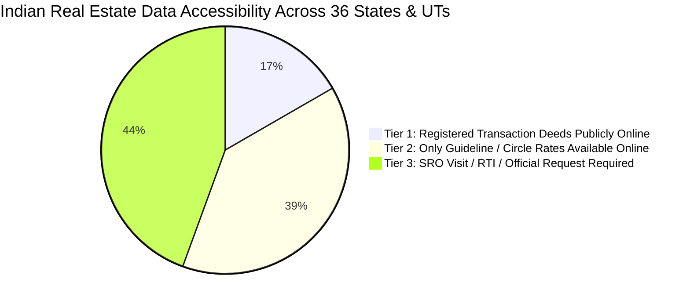

# ModelWatch: State-Wise Real Estate Data-Source & Access Tracker
## National Inventory of Property Registration Portals, Valuation Data Access Tiers, and Government Transparency Baselines

**Last Updated:** November 2026  
**Coverage:** 28 States & 8 Union Territories of India (36 Administrative Jurisdictions)  
**Maintenance Cadence:** Monthly Verification  

---

## 🏛️ Executive Classification Framework

Indian state real estate registration data falls into three distinct operational tiers:

1. **Tier 1 (Actual Registered Transaction Deeds Online):** The state portal provides online public search capabilities to view or download registered sale deeds, Index II copies, or certified consideration values with registration numbers and dates.
2. **Tier 2 (Only Guideline / Circle Rates Available Online):** The state portal publishes minimum government benchmark valuation schedules (Circle Rates, Ready Reckoner, Guidance Value, DLC rates, Jantri), but does not expose individual private transaction deed values to the public without authenticated party credentials.
3. **Tier 3 (In-Person SRO Visit / RTI / Official Request Required):** The state has not digitized deed searches or requires physical application at the Sub-Registrar Office (SRO) or formal Right to Information (RTI) applications to inspect registered records.

---

## 📋 Comprehensive State-Wise Access Matrix

### Tier 1: States with Actual Registered Transaction Prices Accessible Online

| State / UT | Code | Official Department & Portal | Official URL | Data Exposed | Access Constraints | ModelWatch Launch Status |
|:---|:---:|:---|:---|:---|:---|:---:|
| **Maharashtra** | `MH` | Department of Registration and Stamps (SARITA 2.0 / e-Search) | [igrmaharashtra.gov.in](https://igrmaharashtra.gov.in) | **Index II deed copies, consideration amount**, stamp duty, Ready Reckoner ASR | Free e-Search with user login; Captcha on deed lookup | **LAUNCHED (Active Pilot)** |
| **Uttar Pradesh** | `UP` | Stamps and Registration Department (IGRSUP / Prerna) | [igrsup.gov.in](https://igrsup.gov.in) | **Registered deed search, consideration value**, circle rates, e-stamps | Free public deed search by property number/name; Captcha | **LAUNCHED (Active Pilot)** |
| **Tamil Nadu** | `TN` | Registration Department (TNREGINET) | [tnreginet.gov.in](https://tnreginet.gov.in) | **Encumbrance Certificate (EC) with transaction values**, guideline values | Public search available; certified copies require nominal fee | Phase 1 (Queued) |
| **Telangana** | `TG` | Registration and Stamps Department | [registration.telangana.gov.in](https://registration.telangana.gov.in) | **Market value search & Encumbrance Certificate** with deed consideration | Public search; mobile OTP verification | Phase 1 (Queued) |
| **Haryana** | `HR` | Department of Revenue & Disaster Management (Jamabandi) | [jamabandi.nic.in](https://jamabandi.nic.in) | **Registered deed details, deed number, consideration**, collector rates | Free public deed search by tehsil/registration number | Phase 1 (Queued) |
| **Andhra Pradesh** | `AP` | Registration & Stamps Department (CARD) | [registration.ap.gov.in](https://registration.ap.gov.in) | **Registered document details**, market values, certified copies | Public lookup with Captcha | Phase 2 (Queued) |

---

### Tier 2: States with Only Guideline / Circle / Ready Reckoner Rates Online

| State / UT | Code | Official Department & Portal | Official URL | Benchmark Name | Deed Values Online? | ModelWatch Integration Role |
|:---|:---:|:---|:---|:---:|:---:|:---:|
| **Karnataka** | `KA` | Department of Stamps and Registration (Kaveri 2.0) | [k証averionline.karnataka.gov.in](https://kaverionline.karnataka.gov.in) | **Guidance Value** | No (Valuation calculation only) | Guideline Floor Benchmark |
| **NCT of Delhi** | `DL` | Revenue Department (DORIS / e-Subregistrar) | [doris.delhigovt.nic.in](https://doris.delhigovt.nic.in) | **Circle Rates (Category A–H)** | No (Circle rates by colony) | Guideline Floor Benchmark |
| **Gujarat** | `GJ` | Inspector General of Registration (Garvi / Jantri) | [garvi.gujarat.gov.in](https://garvi.gujarat.gov.in) | **Jantri Rates** | No (Jantri valuation only) | Guideline Floor Benchmark |
| **West Bengal** | `WB` | Directorate of Registration and Stamp Revenue (WBREGIS) | [wbregistration.gov.in](https://wbregistration.gov.in) | **Market Value of Land & Property** | No (Property valuation calculator) | Guideline Floor Benchmark |
| **Rajasthan** | `RJ` | Registration and Stamps Department (E-Panjiyan) | [epanjiyan.rajasthan.gov.in](https://epanjiyan.rajasthan.gov.in) | **DLC Rates (District Level Committee)** | No (DLC rates only) | Guideline Floor Benchmark |
| **Madhya Pradesh** | `MP` | Commercial Tax Department (Sampada 2.0) | [mpigr.gov.in](https://mpigr.gov.in) | **Collector Guideline Rates** | No (Guideline rates only) | Guideline Floor Benchmark |
| **Kerala** | `KL` | Registration Department (PEARL) | [keralaregistration.gov.in](https://keralaregistration.gov.in) | **Fair Value of Land** | Limited (Deed requires party auth) | Guideline Floor Benchmark |
| **Punjab** | `PB` | Department of Revenue (NGDRS Punjab) | [punjabrevenue.nic.in](https://punjabrevenue.nic.in) | **Collector Rates** | No (Rates by sub-tehsil) | Guideline Floor Benchmark |
| **Odisha** | `OD` | Inspector General of Registration (e-Registration) | [igrodisha.gov.in](https://igrodisha.gov.in) | **Benchmark Value of Land** | No (Benchmark valuation only) | Guideline Floor Benchmark |
| **Jharkhand** | `JH` | Department of Registration (NGDRS Jharkhand) | [jharnibandhan.gov.in](https://jharnibandhan.gov.in) | **Minimum Evaluation Rate** | No (Circle rates only) | Guideline Floor Benchmark |
| **Chhattisgarh** | `CG` | Commercial Tax - Registration (e-Panjiyan CG) | [epanjiyan.cg.gov.in](https://epanjiyan.cg.gov.in) | **Collector Guideline Rates** | No (Guideline rates only) | Guideline Floor Benchmark |
| **Himachal Pradesh**| `HP` | Department of Revenue (HIMBHOOMI / NGDRS) | [himachal.nic.in/revenue](https://himachal.nic.in/revenue) | **Circle Rates by Mauza** | No (Circle rates only) | Guideline Floor Benchmark |
| **Uttarakhand** | `UK` | Department of Stamps & Registration (UKNGDRS) | [registration.uk.gov.in](https://registration.uk.gov.in) | **Circle Rates by Tehsil** | No (Rates only) | Guideline Floor Benchmark |
| **Goa** | `GA` | Directorate of Civil Registration and Stamps | [ngdrs.goa.gov.in](https://ngdrs.goa.gov.in) | **Minimum Land Rates** | No (Rates only) | Guideline Floor Benchmark |

---

### Tier 3: States & UTs Requiring In-Person SRO Visit / RTI / Official Data Requests

| State / UT | Code | Current Status & Digitization Level | Access Mechanism Needed | Feasibility Rating |
|:---|:---:|:---|:---|:---:|
| **Bihar** | `BR` | BhumiJankari portal provides registration search with partial metadata; full transaction deeds require SRO certified copy application. | SRO Form 1 Inspection / RTI | Medium |
| **Assam** | `AS` | Dharitree portal covers land jamabandi; property transaction deeds managed offline by District Registrar. | SRO In-Person Visit / RTI | Low |
| **Jammu & Kashmir** | `JK` | NGDRS J&K deployed; public deed search disabled for security/privacy. | SRO In-Person Visit | Low |
| **Ladakh** | `LA` | Revenue records managed at SDM/Tehsil level; offline manual deeds. | Physical SRO Inspection | Low |
| **Chandigarh** | `CH` | Chandigarh Administration Revenue Dept; collector rates online, deed search restricted. | Departmental Request | Medium |
| **Meghalaya** | `ML` | Autonomous District Councils govern tribal land transfers; non-tribal transfer restrictions. | In-Person ADC / SRO | Very Low |
| **Mizoram** | `MZ` | Land Revenue & Settlement Department; customary land holding tenures. | District Revenue Office | Very Low |
| **Nagaland** | `NL` | Article 371A customary land ownership; no standardized deed registry. | Customary Village Councils | Very Low |
| **Manipur** | `MN` | Loucha Pathap land records portal active; valley vs hills land disparity. | SRO In-Person Visit | Very Low |
| **Tripura** | `TR` | Jhorokha land records system active; deed search requires SRO application. | Physical SRO Inspection | Low |
| **Arunachal Pradesh**| `AR` | Customary community land ownership; formal deed registration minimal. | DC / District Revenue | Very Low |
| **Sikkim** | `SK` | Revenue & Land Reforms Dept; Old Laws of Sikkim land transfer restrictions. | Revenue Officer Visit | Very Low |
| **Puducherry** | `PY` | Nilamagal portal active; certified copy requires offline SRO fee payment. | SRO In-Person Visit | Medium |
| **Dadra & Nagar Haveli & Daman & Diu** | `DN` | UT Administration portal publishes circle rates; deed records at Collectorate. | In-Person SRO Visit | Low |
| **Andaman & Nicobar Islands** | `AN` | Deputy Commissioner Revenue Office; offline deed indexing. | In-Person SRO Visit | Low |
| **Lakshadweep** | `LD` | Customary island land rights; no open market real estate deeds. | Island Administration | Very Low |

---

## 🎯 Strategic Roadmap for Pan-India Coverage

1. **Launch Phase (Current):**
   - Verified transaction deeds from **Maharashtra (Pune)** and **Uttar Pradesh (Prayagraj)** active in ModelWatch.
   - 84 verified SRO registered deeds + 218 verified market baseline listings.
2. **Phase 1 Expansion (Tier 1 Growth):**
   - Connect **Tamil Nadu (TNREGINET)** and **Haryana (Jamabandi)** registered sales deeds.
   - Connect **Delhi (DORIS)** and **Karnataka (Kaveri 2.0)** guideline floor rate tables.
3. **Phase 2 Expansion (Tier 2 Coverage):**
   - Ingest guideline benchmark grids for Gujarat (Garvi), West Bengal (WBREGIS), and Rajasthan (DLC).
4. **Phase 3 Long-Term (Tier 3 Institutional Access):**
   - Establish formal academic / departmental data requests with state revenue commissioners.
